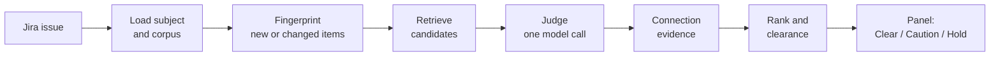
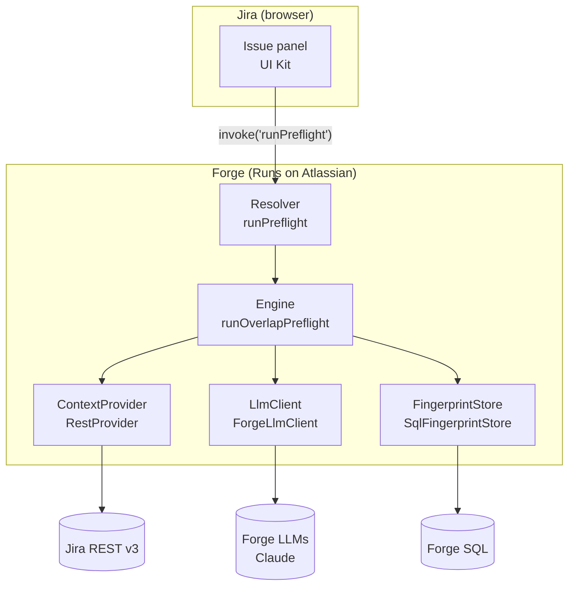

# Preflight

**Clearance for every piece of work.** Preflight is an Atlassian Forge app for Jira. Before work takes off, it checks whether someone is already building the same thing, whether it was already decided, and who it will affect. Then it gives the work a clearance level: **Clear**, **Caution** or **Hold**.

Preflight is an entry for [Codegeist 2026](https://codegeist2026.devpost.com/) in the **Apps for Software Teams** category.

> **Status (November 2026): walking skeleton.** The Overlap check runs end to end from a Jira issue panel on a development site. The Precedent and Downstream checks, the Rovo agent, the MCP tools and the Teamwork Graph provider are planned next. See [Status and roadmap](#status-and-roadmap).

---

## Contents

- [Why Preflight](#why-preflight)
- [What it does](#what-it-does)
- [Status and roadmap](#status-and-roadmap)
- [How the Overlap check works](#how-the-overlap-check-works)
- [Architecture](#architecture)
- [Project layout](#project-layout)
- [Tech stack](#tech-stack)
- [Getting started](#getting-started)
- [Using the panel](#using-the-panel)
- [Testing](#testing)
- [Configuration](#configuration)
- [Data and storage](#data-and-storage)
- [Permissions, privacy and Runs on Atlassian](#permissions-privacy-and-runs-on-atlassian)
- [Platform constraints we design around](#platform-constraints-we-design-around)
- [Dev spikes](#dev-spikes)
- [Troubleshooting](#troubleshooting)
- [Known limitations](#known-limitations)
- [Documentation](#documentation)
- [Development workflow](#development-workflow)

---

## Why Preflight

Teams commit to work without three facts that already exist somewhere in their organization:

1. **Someone else is already doing it.** In Atlassian's State of Teams 2025 survey of 12,000 knowledge workers, half said their teams had unknowingly worked on the same things ([summary](https://www.unleash.ai/artificial-intelligence/atlassian-ai-could-help-workers-stop-wasting-2-4-billion-hours-searching-for-information-every-year/)).
2. **It was already decided**, or already rejected, in a page or a thread the team never saw.
3. **It will hit someone downstream.** Jira notifies assignees, reporters and watchers, so a team that depends on an item rarely hears that it slipped.

AI agents make all three worse. They start work in seconds and carry none of this memory. Preflight turns that organizational memory into a check that runs by itself, and offers the same check to people in Jira and to agents through Rovo and MCP.

The hero check is **unknown overlap**. Two pieces of work look alike, but their owners share no team, goal, link or collaborator. Search can't find this, because nobody knows to ask for it.

---

## What it does

Preflight runs three checks on a work item and combines the results into one clearance level.

| Check | Question it answers | Status |
| --- | --- | --- |
| **Overlap** | Is someone already building this? | Built (Plan 1) |
| **Precedent** | Has this already been decided? | Planned (Plan 2) |
| **Downstream** | Who will this affect if it changes? | Planned (Plan 2) |

### Clearance levels

| Level | When |
| --- | --- |
| **Hold** | An *unknown* overlap with confidence of 0.75 or more, a conflict with an *accepted* decision, or a *high*-severity downstream finding |
| **Caution** | Any other overlap, any decision that isn't "complies", or any downstream finding that isn't "low" |
| **Clear** | Nothing above threshold |

A *known* overlap, one where the two owners are already connected, never causes a Hold. The teams already know about each other, so Preflight only flags it.

### Where people meet it

| Surface | Status |
| --- | --- |
| Jira issue context panel with **Run Preflight** | Built |
| Automatic run when an epic is created | Planned (Plan 2) |
| What-if (slip, block, descope) and downstream alerts | Planned (Plan 2) |
| Rovo agent "Preflight" with five actions | Planned (Plan 3) |
| MCP tools for Claude Code, Cursor and other MCP clients, plus an open-source `skill.md` | Planned (Plan 3); a hello-world MCP tool is deployed as a spike |
| Setup page, demo data, health check | Planned (Plan 4) |

---

## Status and roadmap

The build is split into five plans, one per milestone. Each plan is written when the previous one ships.

| Plan | Scope | Target |
| --- | --- | --- |
| **1 (current)** | Toolchain, engine core, Overlap check end to end on demand, platform spikes | Nov 8, 2026 |
| 2 | Teamwork Graph provider, Precedent, Downstream and what-if, actions, job queue, Forge Realtime, in-flight alerts | Nov 22 |
| 3 | Rovo agent, five shared actions, `rovo:mcp` tools, `preflight-skill` repo | Nov 29 (core feature-complete) |
| 4 | Setup page, demo data seed, health check, visibility gate, polish, evaluation harness, production install link | Dec 13 (code freeze) |
| 5 | Demo video, Devpost text, submission | Dec 20 |

The Codegeist submission deadline is **December 22, 2026 at 12:00 PT**.

### What works today

- A Jira issue panel with a **Run Preflight** button that shows a clearance lozenge and up to three overlaps.
- Each overlap shows the other item (linked), its type (duplicate, complementary or conflicting), the model's confidence, an **Unknown overlap** badge when the owners aren't connected, a one-line reason, and the connection evidence as text.
- Fingerprints are cached in Forge SQL by content hash, so unchanged items are never sent to the model twice.
- 56 unit tests across 14 files, a clean strict TypeScript build, and a clean `forge lint`.

---

## How the Overlap check works



The whole pipeline lives in `runOverlapPreflight()` ([src/engine/runPreflight.ts](src/engine/runPreflight.ts)).

### 1. Load the subject and the corpus

The subject is the issue the panel is open on. The corpus is every open epic and story updated in the last 180 days, fetched with this JQL:

```
issuetype in (Epic, Story) AND statusCategory != Done AND updated >= -180d ORDER BY updated DESC
```

The corpus is read through `POST /rest/api/3/search/jql` in pages of 100. It stops at 1,000 items, after 10 pages, or when Jira repeats a page token ([src/context/restProvider.ts](src/context/restProvider.ts)). Issue descriptions arrive in Atlassian Document Format and are flattened to plain text by `adfToText()`, which handles mentions, emoji, code blocks, tables and nested lists without throwing.

### 2. Fingerprint new or changed items

A fingerprint is a compact description of what a piece of work is for. The model returns JSON:

```json
{
  "intent": "Builds idempotency keys for payment webhooks so that retries never double-charge",
  "tags": ["idempotency-keys", "webhook-retries", "payments"],
  "systems": ["Stripe"],
  "kind": "build"
}
```

- **Caching.** Each fingerprint stores a SHA-256 hash of the title, the first 4,000 characters of the description, and the parent. A stored fingerprint is reused when the hash matches.
- **Budget.** At most 20 new fingerprints per run, five at a time. After 13 seconds no new model calls start, and the remaining items wait for a later run.
- **Incremental saving.** Each fingerprint is written to Forge SQL as soon as it finishes, so a timeout loses only the calls still in flight.
- **Strict parsing.** The intent is required and capped at 300 characters. Tags are kebab-cased, deduplicated and capped at 8. Systems are capped at 8, and an unknown kind becomes `build`. A corpus item whose fingerprint fails to parse is skipped; a subject that fails to fingerprint ends the run with an error.

### 3. Retrieve candidates

Forge LLMs offer no embeddings, so retrieval is lexical ([src/engine/candidates.ts](src/engine/candidates.ts)):

- **Exclusions first.** The subject itself, its parent, its children, its siblings in the same epic, and anything already linked to it in either direction are never candidates.
- **Scoring.** Each remaining item scores `0.7 × (BM25 ÷ best BM25) + 0.3 × Jaccard(tags)`. BM25 runs over title, intent, tags and systems with k1 = 1.2 and b = 0.75 ([src/engine/bm25.ts](src/engine/bm25.ts)). The tokenizer splits on Unicode letters and digits, so non-Latin text works.
- **Cut.** Items scoring 0 are dropped, and the top 15 go to the judge (top 8 in agent mode).

### 4. Judge

One call to the stronger model compares the subject with every candidate ([src/engine/judge.ts](src/engine/judge.ts)). Each candidate is shown as `KEY | title | intent | tags`, using its Jira key, because real issue IDs are opaque numbers. The model returns:

```json
{"judgements": [{"candidateId": "PAY-4", "type": "duplicate", "confidence": 0.82, "reason": "Both build idempotency keys for payment webhooks."}]}
```

The parser is the trust boundary for model output:

- It requires an object with a `judgements` array. A bare array or a lone object yields nothing.
- It accepts only IDs it was given, as a string or a number, and maps them back to issue IDs.
- Unknown types become `none`. Confidence is clamped to 0–1, and NaN or Infinity becomes 0.
- It keeps only the highest-confidence judgement per candidate.
- Prose or code fences around the JSON are tolerated, and output that isn't JSON at all means zero findings, not a crash.

If no candidate scores above zero, the judge is never called and the result is **Clear**.

### 5. Connection evidence

For each judged overlap, Preflight asks how connected the two items' owners already are. Each kind of evidence has a weight:

| Evidence | Weight | Source today (REST proxy) | Source in Plan 2 |
| --- | --- | --- | --- |
| Direct link | 0.9 | Jira issue links in either direction | Same |
| Shared team | 0.8 | Same Jira project | Atlassian Teams from the Teamwork Graph |
| Shared goal | 0.5 | Not available (always false) | Goals linked to the work items |
| Shared collaborator | 0.4 | Same assignee | Contributors from the graph |

The weights combine as `connection = 1 − Π(1 − weight)` over the evidence present ([src/engine/connection.ts](src/engine/connection.ts)). A connection below **0.3** makes it an **unknown overlap**.

### 6. Rank and decide

Overlaps below 0.6 confidence are dropped. The rest are sorted with unknown overlaps first, then by confidence, and the top 3 are shown ([src/engine/overlap.ts](src/engine/overlap.ts)). `decideClearance()` then applies the [clearance rules](#clearance-levels) ([src/engine/clearance.ts](src/engine/clearance.ts)).

A fresh run makes at most one judge call on top of fingerprinting. The result records `modelCalls`, `startedAt` and `finishedAt`.

---

## Architecture



Three rules keep the code testable and portable:

1. **The engine never imports a Forge SDK.** Everything under `src/engine` and `src/domain` is plain TypeScript.
2. **Dependencies are injected.** `runOverlapPreflight()` receives a `PreflightDeps` object: `provider`, `llm`, `fingerprints` and `now`. Tests pass fakes; the resolver passes the Forge adapters.
3. **Adapters are thin.** `RestProvider`, `ForgeLlmClient` and `SqlFingerprintStore` translate between the engine's interfaces and the platform, and contain no business logic.

Plan 2 adds a Teamwork Graph provider behind the same `ContextProvider` interface. The REST provider stays as the fallback for brand-new items and for runs without graph access.

---

## Project layout

```
manifest.yml                    Forge manifest: modules, functions, scopes, runtime
package.json                    Scripts and dependencies
tsconfig.json                   Strict TypeScript (no noEmit: Forge's bundler needs output)
vitest.config.mts               Test runner config (.mts avoids an ESM/CommonJS warning)

src/
  index.ts                      Re-exports every handler the manifest names
  lifecycle.ts                  On install or upgrade: run SQL migrations (logs, never throws)

  domain/
    types.ts                    WorkItem, Fingerprint, Candidate, findings, PreflightResult
    config.ts                   Every threshold, weight, cap and model ID from the spec

  engine/                       Pure logic, no Forge imports
    runPreflight.ts             The Overlap pipeline and PreflightDeps
    text.ts                     tokenize(), hashContent()
    bm25.ts                     BM25 index and search
    candidates.ts               Exclusions and candidate scoring
    fingerprint.ts              Fingerprint prompt, parser, contentHashOf()
    judge.ts                    Judge prompt, parser, judgeId()
    json.ts                     extractJson(): tolerant JSON extraction from model text
    connection.ts               connectionScore(), isUnknownOverlap()
    overlap.ts                  rankOverlaps()
    clearance.ts                decideClearance()
    concurrency.ts              mapWithConcurrency()

  context/
    provider.ts                 ContextProvider interface
    restProvider.ts             Jira REST v3 implementation, CORPUS_JQL, mapIssue()
    adf.ts                      adfToText(): Atlassian Document Format to plain text

  llm/
    client.ts                   LlmClient interface
    forgeLlm.ts                 Adapter over @forge/llm chat()

  store/
    fingerprintStore.ts         FingerprintStore interface and an in-memory version
    migrations.ts               Forge SQL schema (work_fingerprint)
    sqlFingerprints.ts          Forge SQL implementation

  resolvers/index.ts            runPreflight resolver, plus dev-only spike resolvers
  frontend/panel.tsx            UI Kit issue panel
  spikes/hello.ts               Dev-only MCP hello-world action

test/                           Mirrors src/; one *.test.ts per module
  helpers.ts                    Builders (item, f, candidate, ov, dec, down), fakeProvider, scriptedLlm

docs/
  superpowers/specs/            Product and technical spec (PRD + TRD)
  superpowers/plans/            Implementation plans, one per milestone
  spikes/                       Platform spike notes and results
```

---

## Tech stack

| Layer | Technology |
| --- | --- |
| Platform | Atlassian Forge, Node.js 22 runtime (`nodejs22.x`) |
| Product | Jira Cloud (issue context panel); Confluence in later plans |
| UI | UI Kit (`@forge/react`) and `@forge/bridge` |
| Backend | Forge functions and resolvers (`@forge/resolver`, `@forge/api`) |
| AI | Forge LLMs (`@forge/llm`), Atlassian-hosted Claude models |
| Storage | Forge SQL (`@forge/sql`, MySQL-compatible) |
| Data | Jira REST v3; Teamwork Graph API in Plan 2 |
| Language | TypeScript, strict mode |
| Tests | Vitest |

---

## Getting started

### Prerequisites

| Requirement | Notes |
| --- | --- |
| Node.js 22 | Tested with 22.14 |
| Forge CLI 13.3 or later | `npm install -g @forge/cli`; tested with 14.2.0 |
| An Atlassian Cloud developer site | Free at [go.atlassian.com/cloud-dev](https://go.atlassian.com/cloud-dev); add Jira (Confluence comes later) |
| An Atlassian API token | From [id.atlassian.com](https://id.atlassian.com/manage-profile/security/api-tokens); a token **without** scopes |
| Rovo enabled on the site | Only needed for the agent and MCP work in Plan 3 and the MCP spike |

### 1. Install dependencies

```bash
git clone <repo-url> preflight
cd preflight
npm install
```

`rolldown@1.2.15` is pinned as a dev dependency because the 1.2.16 tarball was missing from the npm registry when this was set up. It can be removed once that version installs.

### 2. Log the Forge CLI in

Set your credentials as environment variables, so the CLI never needs an interactive login.

PowerShell (then restart your terminal or editor):

```powershell
setx FORGE_EMAIL "you@example.com"
setx FORGE_API_TOKEN "<your-api-token>"
```

Bash or zsh:

```bash
export FORGE_EMAIL="you@example.com"
export FORGE_API_TOKEN="<your-api-token>"
```

Then confirm:

```bash
forge settings set usage-analytics false   # answers the first-run analytics prompt
forge whoami
```

Never commit the token or put it in a project file.

### 3. Register your own app (forks only)

`manifest.yml` carries the original app ID. If you are working on your own copy, register a new one:

```bash
forge register Preflight --accept-terms
```

The first registration on an account asks you to name a Developer Space. Run this command in a real terminal, because the prompt can't be answered from a non-interactive shell.

### 4. Deploy and install

```bash
forge deploy -e development --non-interactive
forge install -e development --site <your-site>.atlassian.net --product jira --non-interactive
```

A deploy that adds scopes or modules is a major version change. If the CLI asks you to approve it, follow the flag it names (for example `--approve MAJOR_VERSION_RULE`), then upgrade the installation:

```bash
forge install -e development --site <your-site>.atlassian.net --product jira --upgrade --non-interactive
```

Installing an app that uses Teamwork Graph scopes needs **organization admin** rights.

### 5. Iterate with the tunnel

```bash
forge tunnel
```

The tunnel serves your local code to the installed development app, so changes show up without a redeploy. Use `forge logs -e development` to read function logs; each run logs its duration, model call count and clearance.

---

## Using the panel

1. Open any Jira issue on the site where Preflight is installed.
2. Open the **Preflight** panel from the issue's context area on the right.
3. Select **Run Preflight**. A spinner shows *Checking the graph…* while it runs.
4. Read the clearance lozenge and the overlaps under it.

### A quick end-to-end check

1. Create two Jira projects with keys `CHK` ("Checkout") and `PAY` ("Payments Platform").
2. Add three stories:
   - In `CHK`: "Retry and idempotency for payment webhooks"
   - In `PAY`: "Idempotency keys service for payment webhooks"
   - In `PAY`: "CSV export for invoices"
3. Open the `CHK` story and run Preflight.

**Expected result:** the PAY idempotency story is listed and marked **Unknown overlap**, because the two stories are in different projects, aren't linked and have different assignees. The CSV story isn't listed. At a confidence of 0.75 or more, the clearance is **Hold**.

The first run fingerprints every story in the corpus, so it is the slowest. Later runs reuse the cached fingerprints.

---

## Testing

```bash
npm test            # Vitest, all unit tests
npm run test:watch  # watch mode
npm run typecheck   # tsc --noEmit, strict
npm run lint        # forge lint (slow; run on its own)
```

The suite has 56 tests across 14 files. Every engine module has its own test file, and the whole pipeline runs against fakes in `test/engine/runPreflight.test.ts`:

- `fakeProvider(items)` is an in-memory `ContextProvider` that applies the same connection rules as the REST provider.
- `scriptedLlm({...})` is a fake `LlmClient`. It routes on the system prompt prefix (`You fingerprint work items` or `You judge overlap`), returns deterministic fingerprints by default, and counts fingerprint calls.
- `InMemoryFingerprintStore` stands in for Forge SQL.

The tests pin the behaviours that matter most to a user:

- An issue with only a title still fingerprints.
- An empty corpus returns **Clear** without calling the judge.
- Malformed, fenced or non-JSON model output, and IDs the model invents, never produce findings or crash a run.
- One corpus item with a bad fingerprint is skipped, not fatal.
- The subject's parent, children, siblings and linked items are never reported.
- ADF with mentions, emoji, code, tables and nested lists extracts cleanly.
- Jira-shaped data works: numeric issue IDs with keys like `PAY-4`.
- Fingerprints are saved as they finish, and nothing new starts after the time budget runs out.
- Corpus pagination stops on a repeated page token.

The Forge adapters (`ForgeLlmClient`, `SqlFingerprintStore`, the resolver and the panel) aren't unit-tested. They are checked on the development site.

---

## Configuration

All tuning values live in [src/domain/config.ts](src/domain/config.ts), and a test pins the spec's values.

| Constant | Value | Meaning |
| --- | --- | --- |
| `OVERLAP_MIN_CONFIDENCE` | 0.6 | Overlaps below this confidence are not shown |
| `HOLD_OVERLAP_CONFIDENCE` | 0.75 | An unknown overlap at or above this sets Hold |
| `UNKNOWN_CONNECTION_THRESHOLD` | 0.3 | A connection score below this makes an overlap unknown |
| `MAX_OVERLAPS_SHOWN` | 3 | Overlaps shown per run |
| `CANDIDATES_FULL` | 15 | Candidates sent to the judge from the panel |
| `CANDIDATES_AGENT` | 8 | Candidates sent to the judge in agent mode (faster) |
| `CORPUS_WINDOW_DAYS` | 180 | How far back the corpus looks |
| `EVIDENCE_WEIGHTS` | 0.9 / 0.8 / 0.5 / 0.4 | Direct link / shared team / shared goal / shared collaborator |
| `MAX_NEW_FINGERPRINTS_PER_RUN` | 20 | New fingerprints per run |
| `FINGERPRINT_CONCURRENCY` | 5 | Fingerprint calls in flight at once |
| `FINGERPRINT_DEADLINE_MS` | 13000 | After this, no new fingerprint calls start |
| `MODELS.fast` / `MODELS.strong` | `claude-sonnet-5` | Fingerprint and judge models; `fast` moves to a smaller model once the models spike confirms one |

---

## Data and storage

Preflight stores one table in Forge SQL. Each installation gets its own database.

```sql
CREATE TABLE IF NOT EXISTS work_fingerprint (
  item_id VARCHAR(64) PRIMARY KEY,
  intent TEXT NOT NULL,
  tags TEXT NOT NULL,          -- JSON array
  systems TEXT NOT NULL,       -- JSON array
  kind VARCHAR(16) NOT NULL,
  content_hash CHAR(64) NOT NULL,
  fingerprinted_at DATETIME NOT NULL
)
```

- **Migrations** run through `migrationRunner` on app install and upgrade (`src/lifecycle.ts`), and again at the start of each panel run. Migrations are idempotent.
- **Reads** select by primary key in chunks of 100 IDs, well inside Forge SQL's 5-second SELECT limit.
- **Writes** are upserts, one row per fingerprint, so a retry is always safe.
- **No person data.** The table holds descriptions of work, never scores or profiles of people.

The spec's later tables (`decision`, `preflight_run`, `finding`, `downstream_alert`) arrive with Plans 2 and 3.

---

## Permissions, privacy and Runs on Atlassian

### Scopes

| Scope | Why |
| --- | --- |
| `read:jira-work` | Read issues, links and the corpus search |
| `read:jira-user` | Read assignees for collaborator evidence |
| `storage:app` | App storage |
| `read:graph:user:atlassian`, `read:graph:team:atlassian` | Teamwork Graph spike (Plan 2 provider) |

### Data residency

- The manifest declares **no outbound fetch permissions**. All compute and data stay on Forge: Forge functions, Forge SQL and Atlassian-hosted models through Forge LLMs. This keeps the app eligible for the Runs on Atlassian badge.
- MCP access, when it ships, only happens when a user connects their own MCP client and approves it through OAuth.

### Safety measures

- **Model output is untrusted.** It must parse as JSON, match a strict shape, and cite only the IDs the model was shown.
- **Prompts treat work item text as data.** Both system prompts tell the model so, and candidate fields are collapsed to one line, so an issue title can't forge extra rows in the judge prompt.
- **No scores about people.** Connection evidence describes teams and work, and it is shown as plain facts.

### Before the production install link

The panel reads Jira as the app (`asApp`), so today it could show a viewer an issue they aren't allowed to browse. That is acceptable on a single-person development site, but it must be fixed before the app is shared with anyone. Plan 4 adds a server-side visibility gate that checks each finding against the viewer's permissions before anything leaves the resolver, and trims the response to the fields the panel shows.

---

## Platform constraints we design around

| Constraint | Effect on Preflight |
| --- | --- |
| UI resolvers can't set `timeoutSeconds` and run at the platform default (about 25 seconds) | Each run is capped at 20 new fingerprints, saves each one as it finishes, and stops starting calls after 13 seconds. Plan 2 moves full runs onto an async queue (up to 15 minutes) and streams progress with Forge Realtime |
| Forge LLMs have no embeddings | Retrieval uses BM25 and tag overlap, and the model only judges the top candidates |
| New apps can't send raw Cypher to the Teamwork Graph | Plan 2 uses curated queries first and registers persisted queries for the rest |
| `asApp()` has no `requestTeamworkGraph` (only `asUser()` does) | Graph queries run when a person starts a check; background runs fall back to REST |
| The Teamwork Graph API needs an allowlist, and installing needs an org admin | Access was requested with the app ID; every check also works without the graph |
| An app can call the Teamwork Graph API or provide a connector, never both | Preflight reads the graph and does not run a connector |
| A missing graph scope returns empty results, not an error | Plan 4's health check runs one canary query per object type |
| Forge's TypeScript bundler honours `noEmit` | `tsconfig.json` leaves it out; `npm run typecheck` passes `--noEmit` itself |

---

## Dev spikes

The development build includes a **Dev spikes** section at the bottom of the panel. It only appears when the environment is `DEVELOPMENT`. Each spike answers one platform question for the next plans:

| Spike | Question | Notes |
| --- | --- | --- |
| **Spike: models** | Which Claude models are active in Forge LLMs? | [docs/spikes/models.md](docs/spikes/models.md) |
| **Spike: Teamwork Graph** | Does the graph answer as the user, and as the app? | [docs/spikes/twg.md](docs/spikes/twg.md) |
| `spike-hello` MCP tool | Does a `rovo:mcp` tool reach Claude Code end to end? | [docs/spikes/mcp.md](docs/spikes/mcp.md) |

Each note has exact steps to run the spike and a place to record the result. Teamwork Graph allowlisting is tracked in [docs/spikes/twg-allowlist.md](docs/spikes/twg-allowlist.md). All spike code is removed in Plan 2, before any production deploy.

---

## Troubleshooting

| Symptom | Cause | Fix |
| --- | --- | --- |
| `Prompts can not be meaningfully rendered in non-TTY environments` | The CLI's first-run analytics question | `forge settings set usage-analytics false` |
| `forge register` fails while creating a Developer Space | The space name prompt needs a real terminal | Run `forge register Preflight --accept-terms` in an interactive terminal |
| Deploy fails with `TypeScript emitted no output` | `noEmit: true` in `tsconfig.json` | Leave `noEmit` out of `tsconfig.json`; use `npm run typecheck` for checking |
| `forge lint` rejects `timeoutSeconds` | Only consumer and scheduled-trigger functions may set it | Leave it off UI resolvers |
| `npm install` 404s on a `rolldown` tarball | A missing package version on the registry | Keep the `rolldown@1.2.15` dev dependency |
| The first run times out or is slow | Many unfingerprinted items | Run it again: finished fingerprints are already saved, so each run gets further |
| The panel shows Clear on a large site | Only part of the corpus was fingerprinted this run | Run again until the corpus is cached (a "Partial check" label arrives in Plan 2) |
| Teamwork Graph queries return nothing | Missing scope or no allowlist yet; both fail silently | Check the granted scopes and the allowlist status |
| The Preflight panel doesn't appear on an issue | The app isn't installed on that site or product | Run `forge install` for Jira on that site |

---

## Known limitations

- **Connection evidence uses REST stand-ins.** Being in the same Jira project counts as a shared team, and shared goals are always false. So two items in one project can't be an unknown overlap or cause a Hold. Plan 2 replaces these with real teams and goals from the Teamwork Graph.
- **A partial run can look like a full Clear.** If only part of the corpus was fingerprinted, or the judge's answer was cut short, the panel still says Clear. Plan 2 adds coverage information and a "Partial check" label.
- **Visibility.** Results are read as the app, not filtered by the viewer's permissions yet. See [Before the production install link](#before-the-production-install-link).
- **Runs are on demand only.** Automatic runs on epic creation, the Precedent and Downstream checks, the Rovo agent and the MCP tools come in Plans 2 and 3.
- **The fast and strong models are the same** until the models spike confirms a smaller one.
- **Spike code is present** in the development build: two spike resolvers, the `spike-hello` action and the graph scopes. It is removed before production.

---

## Documentation

| Document | What's in it |
| --- | --- |
| [Product and technical spec](docs/superpowers/specs/2026-10-29-preflight-design.md) | Research, ideation, PRD, TRD, submission plan, risks |
| [Plan 1: walking skeleton](docs/superpowers/plans/2026-10-29-preflight-plan-1-walking-skeleton.md) | The current build, task by task |
| [Spike notes](docs/spikes/) | Platform questions, how to run each spike, and results |

### Codegeist 2026 submission

- **Category:** Apps for Software Teams.
- **Bonus prizes:** Best app with Atlassian MCP first, with Best apps with Teamwork Graph integration and Best Agents also selected. A submission can win one grand prize and one bonus prize.
- **Judging:** five equal criteria (technological implementation, design, potential impact, innovation, presentation). Judges don't have to watch past minute 3 of the video.
- **Deadline:** December 22, 2026, 12:00 PT. The plan targets submitting on December 20.

---

## Development workflow

- **Test first.** Each engine change starts with a failing test in the matching `test/` file.
- **Keep the engine pure.** Nothing under `src/engine` or `src/domain` imports a Forge package. Platform code goes in an adapter behind an interface.
- **Keep numbers in config.** Thresholds, weights and caps live in `src/domain/config.ts`, never inline.
- **Check before committing:** `npm test`, `npm run typecheck`, then `npm run lint`.
- **One plan per milestone.** Work happens on a branch per plan (currently `plan-1-walking-skeleton`) and is merged after a whole-branch review.
